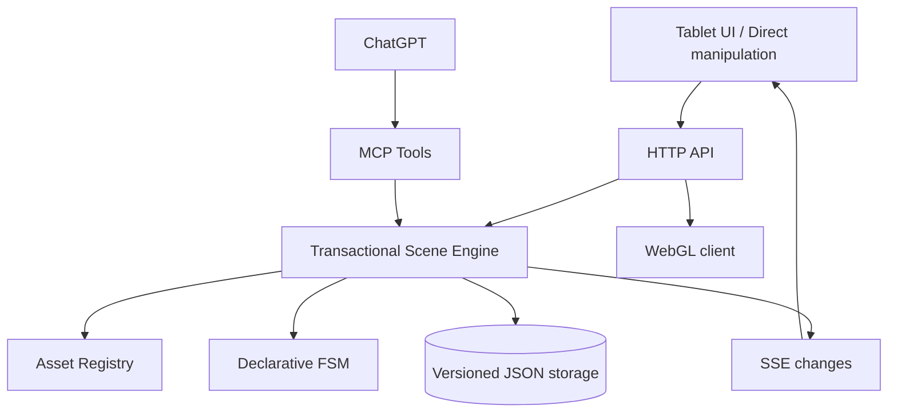

# Arsitektur Teknis — OSCE Playground

## Konsep

**Tablet adalah controller; ChatGPT adalah world builder; server adalah sumber kebenaran.** Semua operasi klinis yang ditampilkan merupakan simulasi visual sampai ada modul medis khusus yang divalidasi.

## Pembagian komponen

**web/render3d.js** mengelola WebGL shader, box/sphere/cylinder geometry, hierarchical joint matrices, orbit/pan/zoom, proyeksi titik kontrol dan input pointer. Tidak boleh membuat keputusan medis. Tidak mengirim request per frame. Perubahan dikirim setelah gesture selesai. Jika pointercancel atau sentuhan kedua muncul, edit sementara dibatalkan sebelum mengaktifkan kamera multitouch.

**web/app.js** mengelola Add / Ask GPT / Practice, panel seleksi kontekstual, builder lanjutan, komunikasi HTTP/MCP App, draft lokal dan sinkronisasi. Antarmuka saat ini memakai polling terjadwal sekitar 5 detik ketika terlihat, plus reload setelah setiap mutasi; endpoint SSE tersedia tetapi belum dipakai oleh client v0.3. Panjang re-render DOM belum dioptimasi untuk proyek raksasa; batasi dulu jumlah entity.

**server/core.js** memegang scene authoritative, asset definitions, behavior definitions, validasi operasi, commit atomik dan riwayat undo/redo. Satu transaksi dapat mencakup 1–50 operasi. Jika ada operasi tidak valid, seluruh perubahan scene dalam transaksi di-rollback.

**server/mcp.js** mengekspos operasi server sebagai tools JSON-RPC MCP. Input model tidak langsung menyentuh file atau runtime JavaScript.

**server/index.js** melayani UI dan API dari satu origin, mengamankan API dengan bearer token jika diaktifkan, mem-push event ke browser, mempersist JSON menggunakan file sementara lalu rename. Untuk produksi ganti storage dan autentikasi.

## Data model

Scene (revisi monotonic) menyimpan `schemaVersion`, `id`, `title`, `environment`, `scenario`, `entities`.

Entity memiliki `id`, `type`, `name`, `position`, `rotation`. `character` memiliki `role`, `pose` (joint axes dalam derajat). `asset` memiliki `assetId`, `status`, dan opsional `attachedTo`, `anchor`.

Asset blueprint memiliki `id`, `name`, `category`, `parts` (shape/position/size/color), `anchors`, dan `behaviorId`. Behavior memiliki `states`, `initial`, `transitions` ({from, action, to, label}). Aset dan behavior buatan AI diberi `custom: true` dan `version`.

Snapshot JSON bisa diekspor/impor. `schemaVersion=1`. Migrasi data versi berikutnya membutuhkan skrip migrasi eksplisit; bukan mengubah bentuk diam-diam.

## 3D puppet rig

Root → hip → spine → chest → neck/head dan cabang shoulder/elbow/wrist serta hip/knee/ankle. Karakter berupa tabung/bola sederhana dengan posisi diproyeksikan menggunakan matriks model-view-projection. Kamera dapat diputar bebas. Joint yang dapat diedit termasuk leher, tulang belakang, kedua bahu, siku, pergelangan tangan, pinggul, lutut dan pergelangan kaki.

Model ini **bukan representasi anatomi presisi**. Tidak ada kompleks scapulothoracic, gerak scapula, deformasi otot, digit/finger joints, gaya, atau resistensi jaringan. Range -180 sampai 180 hanya batas keamanan angka, bukan rentang normal klinis.

## Asset factory

AI dapat menciptakan blueprint parametrik dari sejumlah bagian `box`, `sphere` dan `cylinder`, maksimal 60 bagian per aset. Shape/part memiliki posisi, skala, warna. Keluaran JSON tidak pernah dieksekusi sebagai kode. Semua nilai divalidasi, termasuk ID, angka finite, panjang string, jumlah komponen, ukuran >0, warna hex.

Asset baru didaftarkan dalam registry dan dapat dipakai di banyak scene. Revisi meningkatkan `version`, bukan mengubah ID object instance yang sudah memakai aset.

Versi lanjutan dapat menambahkan tube/strap/lathe mesh, impor GLB, LOD, component graph, procedural materials dan aset 3D via layanan generasi eksternal. Ini belum diimplementasikan.

## Behavior engine

Finite-state machine terdiri dari states dan transitions. Pengguna/model memanggil `trigger_action`. Transisi sah hanya terjadi jika ada `from` yang cocok dengan status saat itu. Tidak ada `eval`, `new Function`, script arbitrary, while-loop, atau event chain otomatis. Tidak dapat memicu loop tak hingga dengan sendirinya. Ini bukan engine perhitungan fisiologi.

Contoh untuk manset: `free --wrap--> wrapped --inflate--> inflated --deflate--> wrapped --remove--> free`. Aksi dapat mengubah status, visualisasi warna/skala, dan efek attach/detach/move; belum ada tekanan fisik atau penghitungan tekanan darah.

## Sinkronisasi

- Setiap client membaca revision yang diketahui.
- Operasi menulis memuat `baseRevision`.
- Server menolak mismatch dengan HTTP 409.
- Setelah transaksi berhasil, server meningkatkan revision, persist, dan kirim event SSE.
- Browser melakukan refresh snapshot sesudah event.
- Undo/redo memajukan revision, tidak memutar mundur revision global.

**Keterbatasan saat ini:** belum ada merge berbasis entity / concurrent multi-user editing. Jika dua pengguna mengubah scene serentak, salah satu perlu reload dan retry manual. Jangan deploy untuk kolaborasi intensif tanpa concurrency policy yang lebih kuat.

## Perjalanan menuju produksi

1. Monorepo TypeScript; static schema + generated API docs.
2. MCP SDK v2 resmi; end-to-end client compatibility testing.
3. Multi-user database PostgreSQL dengan transaksi / change log.
4. OAuth, granular scopes, approval UX, audit log, project-based permissions.
5. WebGL/WebGPU performance profiling di iPadOS/Android.
6. Unit/integration/e2e tests pada perangkat, screenshot regression, accessibility audits.
7. Modul OSCE tervalidasi oleh dosen/klinisi dan referensi guideline.
